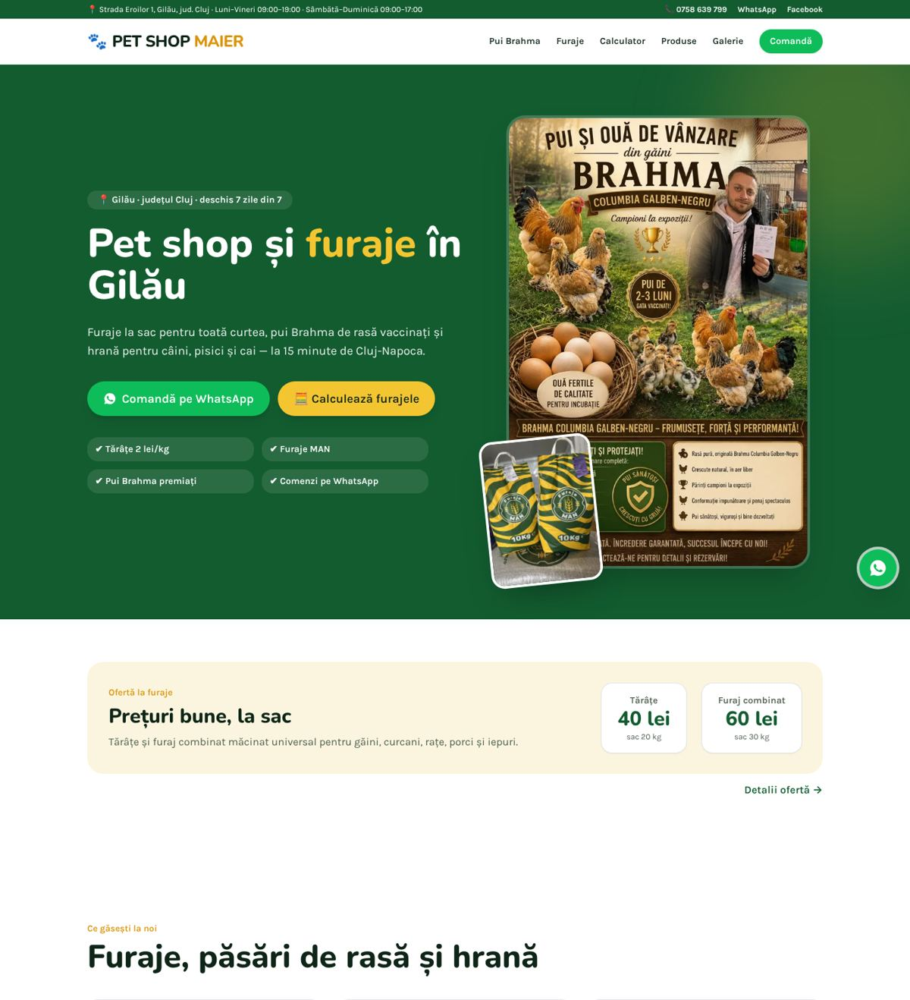
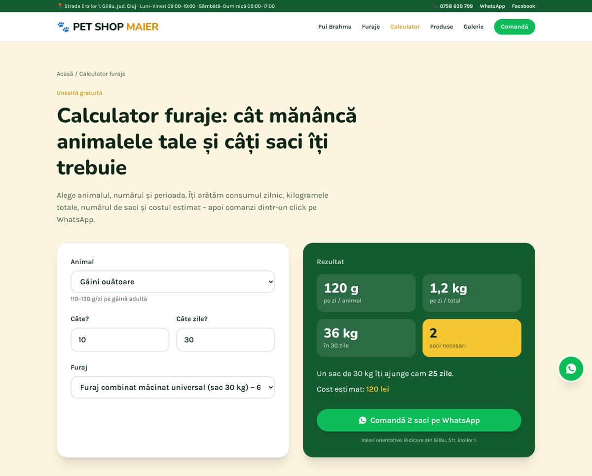

# PET SHOP MAIER – pet shop și furaje în Gilău, Cluj

**Site live:** https://pethopmaier.shop





## Ce conține

- **Calculator furaje** (`/calculator-furaje`) – consum zilnic, kg, saci și cost estimat, cu comandă directă pe WhatsApp.
- **Galerie reală** (`/galerie`) – pozele de pe pagina de Facebook, afișate întregi (fără crop), cu lightbox.
- **Pagini SEO** pe căutările din nișă: pui Brahma de vânzare, Furaje MAN, ofertă tărâțe/furaj combinat, furaje vaci de lapte, hrană cai, hrană prepelițe + ghidurile existente.
- **SEO tehnic**: canonical și og:url absolute, og:image pe fiecare pagină, JSON-LD (PetStore/LocalBusiness cu program, geo și oferte, FAQPage, BreadcrumbList, Product, ImageGallery, WebApplication), sitemap cu imagini.
- **WhatsApp**: orice mesaj pornește cu „Bună, am văzut magazinul dvs. pe https://pethopmaier.shop și m-ar interesa …”.

This project was built with [Lovable](https://lovable.dev).

**Live app**: https://pet-shop-maier.lovable.app

## Build with Lovable

Continue developing this project in the [Lovable editor](https://lovable.dev/projects/4b2558b1-5f11-42b2-8e84-fdc3c8f1d2da).

- **Ship faster**: describe what you want to build and Lovable handles the code.
- **Stay in sync**: every change made in Lovable is committed straight to this repository.
- **Full ownership**: this code is yours. Push to `main` on GitHub and your changes sync back into Lovable, ready for your next prompt.

## Development

Prefer working locally? You need Node.js and npm — [install with nvm](https://github.com/nvm-sh/nvm#installing-and-updating).

```sh
git clone <this-repository-url>
cd <repository-name>
npm i
npm run dev
```
