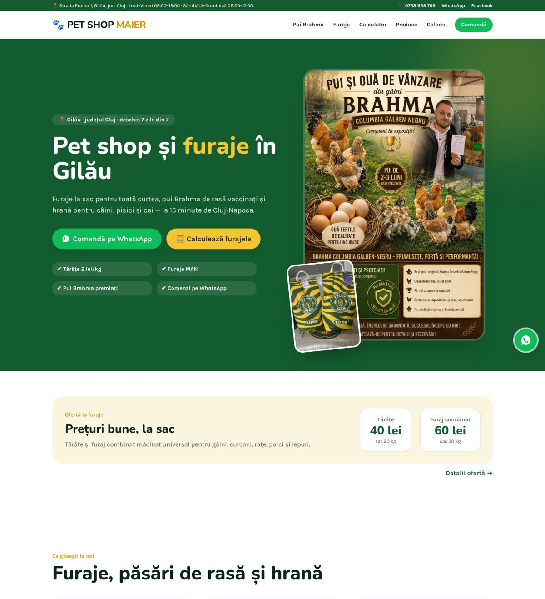
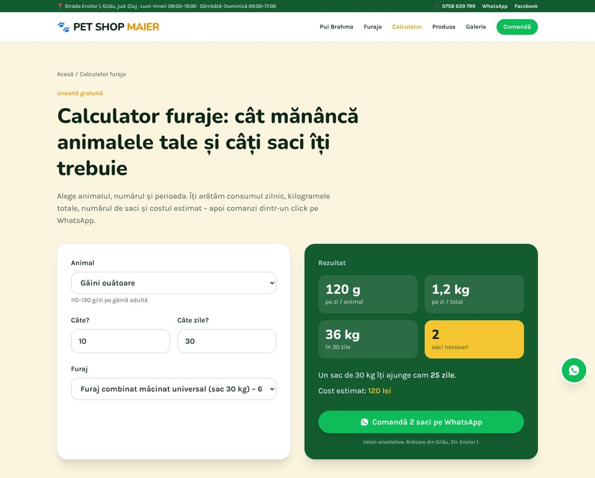

# PET SHOP MAIER – pet shop și furaje în Gilău, Cluj

**Site live:** https://pethopmaier.shop





## Ce conține

- **Calculator furaje** (`/calculator-furaje`) – consum zilnic, kg, saci și cost estimat, cu comandă directă pe WhatsApp.
- **Galerie reală** (`/galerie`) – pozele de pe pagina de Facebook, afișate întregi (fără crop), cu lightbox.
- **Pagini SEO** pe căutările din nișă: pui Brahma de vânzare, Furaje MAN, ofertă tărâțe/furaj combinat, furaje vaci de lapte, hrană cai, hrană prepelițe + ghidurile existente.
- **SEO tehnic**: canonical și og:url absolute, og:image pe fiecare pagină, JSON-LD (PetStore/LocalBusiness cu program, geo și oferte, FAQPage, BreadcrumbList, Product, ImageGallery, WebApplication), sitemap cu imagini.
- **WhatsApp**: orice mesaj pornește cu „Bună, am văzut magazinul dvs. pe https://pethopmaier.shop și m-ar interesa …”.

## Dezvoltare

Ai nevoie de Node.js 22+ și [Bun](https://bun.sh).

```sh
git clone https://github.com/alexalghisi/pet-shop-maier.git
cd pet-shop-maier
bun install
bun run dev
```

`bun run test` rulează testele, `bun run build` construiește varianta de producție.
